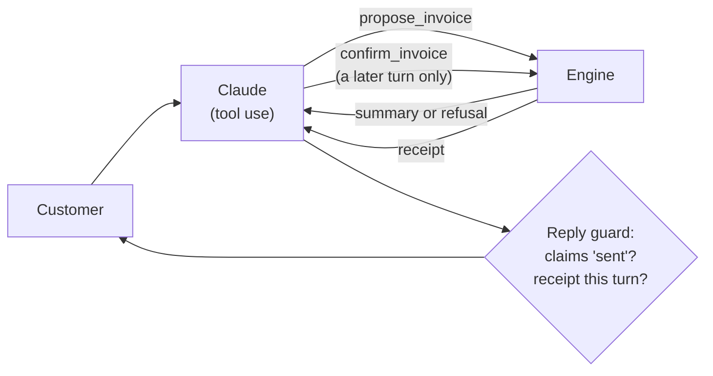

# guarded-llm-actions

**The model talks; the server decides.** A small, runnable demo of the guards I use when an LLM agent takes an action that touches money, tax or identity.

It is a companion to the case study [An AI agent that issues tax invoices, and what I learned measuring where it fails](https://github.com/PabloCorreia/llm-invoicing-agent-case-study). The production system is private; this repo rebuilds the core ideas from scratch, with fictional data only.

## The four guards

| Guard | What goes wrong without it | Where |
|---|---|---|
| **Validate the shape, not the length** | Brazil's tax IDs now contain letters. A digits-only rule collapses different IDs into one key, and a length check accepts a company *name* as an ID. | [`tax_id.py`](src/guarded/tax_id.py) |
| **No default, and count what goes in** | A fail-safe default turns a broken lookup into a plausible number. No error, nobody notices. | [`rates.py`](src/guarded/rates.py) |
| **Match duplicates on facts, not wording** | The model paraphrases the description, so a text-based check lets the same invoice through twice. | [`engine.py`](src/guarded/engine.py) |
| **"Sent" needs a receipt** | The model proposes and confirms in the same turn, or simply *says* it sent something it never did. | [`engine.py`](src/guarded/engine.py), [`guard.py`](src/guarded/guard.py) |



## Run it

Python 3.10+. No dependencies for the walkthrough or the tests.

```bash
python demo.py                                      # offline walkthrough of the four guards
PYTHONPATH=src python -m unittest discover -s tests  # 20 tests
```

The tests check the tax-ID check digits against a **second, independent implementation**. A checker that shares code with what it checks does not check anything.

### Live mode (optional)

```bash
pip install anthropic
python demo.py --live
```

You chat with Claude (default model `claude-opus-5-5`, override with `DEMO_MODEL`) through a manual tool-use loop in [`agent.py`](src/guarded/agent.py). Credentials come from the environment (`ANTHROPIC_API_KEY` or an `ant auth login` profile). This mode makes real API calls and costs tokens. At the end it prints the engine's audit trail.

## What this is not

- Not the production code, and not a tax tool: it issues nothing, and the "invoice numbers" are fake.
- Every tax ID used here is fictional and generated at run time. No real identifier is stored in this repo.
- The reply guard is a pattern match, a last line of defence. The real protection is that only the engine can issue, and only from a confirmation the customer answered.

## License

MIT
